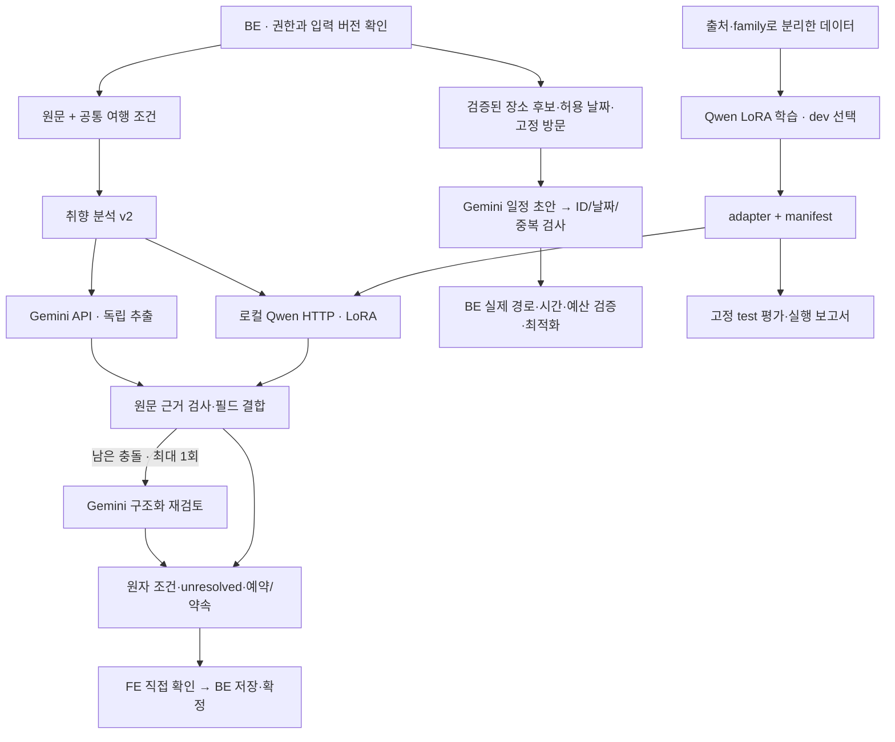

# 충북 여행 계획 · AI

자유 입력 여행 메모를 구조화하고, 검증된 장소 후보로 일정 초안을 제안하는 **충북 단체여행 플래너의 Python AI 패키지**입니다. Gemini API와 로컬 Qwen을 사용하며, Qwen LoRA 학습·서빙·평가 도구를 함께 관리합니다.

## 목차

- [프로젝트 개요](#프로젝트-개요)
- [기술 설계 및 선택 (ADR)](#기술-설계-및-선택-adr)
- [아키텍처 다이어그램](#아키텍처-다이어그램)
- [실행 방법](#실행-방법)
- [확인 방법과 학습 재현](#확인-방법과-학습-재현)
- [확인된 범위와 한계](#확인된-범위와-한계)
- [디렉터리 구조](#디렉터리-구조)
- [상세 문서](#상세-문서)

## 프로젝트 개요

여행 요청에는 선호·회피·필수 조건·횟수·예약·시간 제한이 함께 들어갑니다. 이 저장소는 이를 사용자가 확인할 수 있는 조건으로 바꾸고, BE가 선별한 장소 안에서 방문 초안을 만듭니다.

AI 결과는 **확인 전 제안**입니다. 사용자 권한·원문/조건 버전·DB 저장·장소 선택·경로 최적화·실제 이동/시간/예산 검증은 BE가 담당합니다. 이 패키지 단독으로 확정 일정을 저장하지 않습니다.

### 주요 기능

| 기능 | 공개 함수·도구 | 결과와 경계 |
| --- | --- | --- |
| 취향 분석 v2 | `interpret_personal_draft_v2` | Gemini/Qwen의 원자 조건·예약/약속을 원문 근거로 검증·결합하고, 모호한 항목은 `unresolved`로 반환 |
| 기존 취향 분석 | `interpret_personal_draft` | v1 호환 제안. 신규 v2와 계약을 구분 |
| 여행 요청 미리보기 | `create_trip_preview`, `chungbuk-trip-preview` | 고정 여행 조건과 메모를 조합한 `pending_review` 결과 |
| 후보 일정 초안 | `draft_candidate_itinerary`, `validate_candidate_itinerary` | 후보 ID·허용 날짜·중복·고정 위치 검사. 경로·시간·예산 검증은 별도 |
| 호환용 태그 제안 | `normalize_confirmed_preferences` | 지원 태그 기반 검토 제안. 새 생성 흐름의 두 번째 필수 AI 단계로 사용하지 않음 |
| 학습·평가·서빙 | `training`, `evaluation`, `serving` | Qwen LoRA, 출처별 데이터 분리, 고정 시험 비교, 로컬 HTTP 추론 |

### 저장소 역할

| 저장소 | 담당 |
| --- | --- |
| [FE](https://github.com/woowangthon/WOOWANGTHON_TEAM_17_FE) | 원문 입력·해석 수정·직접 확정·공동 캔버스 |
| [BE](https://github.com/woowangthon/WOOWANGTHON_TEAM_17_BE) | 권한·버전·저장, 장소 필터·점수, 경로 검증·일정 최적화 |
| **이 저장소 · AI** | 자연어 해석·결합·초안 제안, 모델·데이터 재현 자료 |

## 기술 설계 및 선택 (ADR)

현재 구현과 [원자 조건 v2 계약](docs/atomic-contract.md), [재현 절차](docs/reproducibility.md)를 기준으로 정리합니다.

| ADR | 선택 | 이유와 트레이드오프 |
| --- | --- | --- |
| AI-01 · 통합 방식 | Python 3.12+ 패키지, BE의 editable dependency | HTTP 게이트웨이를 별도로 두지 않고 함수를 재사용합니다. Gemini만 쓰는 실행에는 별도 AI 서버가 필요 없지만, Qwen 사용 시 모델 서비스가 필요합니다. |
| AI-02 · 취향 표현 | 근거·방향·중요도·범위·횟수를 분리한 원자 조건 v2 | 단순 키워드로 잃기 쉬운 필수/선호·횟수·개인/일행 차이를 보존합니다. 현재 스키마로 확정할 수 없는 의미는 `unresolved`로 남으며 완전한 자연어 이해를 보장하지 않습니다. |
| AI-03 · 모델 결합 | Gemini + Qwen 독립 병렬 분석, 근거 기반 필드 결합 | 공통 deadline 안에서 각 모델의 근거 있는 조건을 합칩니다. 남은 충돌은 Gemini에 최대 한 차례 재검토를 요청합니다. 호출 비용·GPU·지연이 늘고 결합이 항상 단독 모델보다 좋지는 않습니다. |
| AI-04 · 장애 처리 | degraded 결과 + 선택적 strict 모드 | 하나의 유효 제공자만 남으면 `degraded=true`로 반환하며 `PREFERENCE_AI_STRICT=true`이면 실패합니다. 사용할 결과가 전혀 없으면 오류입니다. 모호한 걷기 제한을 숫자로 추측하거나 v2 필수 추가 질문을 만들지 않습니다. |
| AI-05 · 로컬 모델 | 고정 revision의 Qwen3.5-4B + LoRA | 기반 모델 전체 대신 adapter를 학습·식별·배포합니다. 학습에 Torch/Transformers/PEFT와 GPU가 필요하고 모델·adapter 파일은 Git에 포함하지 않습니다. Gemini 자체를 학습하거나 두 모델을 스태킹 학습한 구조는 아닙니다. |
| AI-06 · 일정 제안 | BE가 검증한 후보 ID와 일정 컨텍스트만 사용 | 모델의 임의 장소 생성을 막고 결과를 기계적으로 검사합니다. 결과는 `requiresReview=true`, 경로·시간·예산은 미검증이며 최종 최적화는 BE에 남습니다. |
| AI-07 · 재현성과 품질 | 데이터 family별 분리, dev 기준 checkpoint, manifest/SHA-256, strict tuple 평가 | 학습·시험 출처와 가중치 동일성을 추적합니다. 합성 시험의 일치 점수는 사람 정확도·만족도·출시 준비도를 의미하지 않습니다. |

## 아키텍처 다이어그램



그림은 `ensemble` 모드를 나타냅니다. `gemini`·`qwen` 단독 모드도 지원합니다. 개인 취향 분석용 Qwen과 일정 초안용 Gemini의 역할은 구분됩니다.

## 실행 방법

명령은 저장소 루트의 PowerShell 기준입니다. **기본 패키지 사용**, **Qwen 서빙**, **학습/평가**는 필요한 범위만 준비합니다.

### 1. 기본 패키지 설치

Python **3.12 이상**이 필요합니다. 기본 설치에는 GPU 라이브러리가 포함되지 않습니다.

```powershell
py -3.12 -m venv .venv
.\.venv\Scripts\Activate.ps1
python -m pip install -e .
if (-not (Test-Path .env)) { Copy-Item .env.example .env }
```

AI 루트의 개인 `.env`에 `GEMINI_API_KEY`를 설정합니다. `GEMINI_MODEL`의 코드 기본값은 `gemini-3.5-flash-lite`입니다. 모델 사용 가능 여부는 실제 계정/호출 환경에서 확인해야 합니다.

| 설정 | 용도·적용 위치 |
| --- | --- |
| `GEMINI_API_KEY`, `GEMINI_MODEL` | 프로세스 환경이 AI 루트 `.env`보다 우선. BE 작업 디렉터리의 `.env`를 Gemini 설정 파일로 검색하지 않음 |
| `PREFERENCE_AI_PROVIDER` | `gemini` / `qwen` / `ensemble`. 함수의 미지정 기본값은 `gemini`, 저장소 `.env.example`은 `ensemble` 예시 |
| `QWEN_PREFERENCE_URL` | Qwen 추론 주소. 기본 `http://127.0.0.1:18117/v1/interpret` |
| `PREFERENCE_AI_STRICT` | 일부 제공자 실패도 오류로 처리할지 선택. 기본 `false` |
| `QWEN_MODEL_PATH`, `QWEN_MODEL_REVISION`, `QWEN_ADAPTER_PATH` | native 서빙의 기반 모델·고정 revision·adapter 경로 |

Gemini 설정을 읽는 것만으로 `.env`의 다른 값까지 프로세스에 주입되지는 않습니다. **BE에서 호출할 때 provider/URL/strict는 BE `.env` 또는 실행 환경에 설정**합니다. native 서빙·평가 CLI는 AI `.env`를 읽습니다. Python에서 직접 호출할 때는 `provider="ensemble"`처럼 인수로 명시할 수도 있습니다.

### 2. 여행 요청 미리보기 CLI

Gemini 키가 준비된 기본 환경에서 실행합니다. 실제 API를 호출합니다.

```powershell
chungbuk-trip-preview .\examples\trip_input.json
```

[입력 예제](examples/trip_input.json)에는 `dates.start/end`, `transport`, `total_budget_won`, `departure.time/region`, `headcount`, `preferences_text`가 필요합니다. `headcount`는 모임방에서 확정한 인원이며 결과는 미확정 `pending_review` 상태입니다.

### 3. BE와 연결

BE 가상환경에 이 저장소를 설치합니다. 아래 명령은 **BE 루트**에서 실행합니다.

```powershell
.\.venv\Scripts\python.exe -m pip install -e ..\WOOWANGTHON_TEAM_17_AI
```

```python
from chungbuk_trip_ai import interpret_personal_draft_v2

original_text = "저는 숲길을 좋아해요. 얼마나 걸을 수 있을지는 모르겠어요."
conditions = {"startDate": "2026-11-20", "endDate": "2026-11-21"}
result = interpret_personal_draft_v2(original_text, conditions, provider="ensemble")
```

`conditions`는 날짜 문맥만 담은 축약 예시입니다. 실제 BE에서는 본인 권한·현재 버전을 확인한 원문과 전체 공통 조건을 전달합니다. 다음은 가능한 출력의 일부이며, 식별자·digest·조건의 나머지 필드는 생략했습니다. 실제 모델 응답이 이 예시와 같음을 보장하지는 않습니다.

```json
{
  "atomicPreferences": {
    "conditions": [
      {
        "dimension": "activity",
        "target": "숲길",
        "polarity": "prefer",
        "priority": "preferred",
        "evidence": "저는 숲길을 좋아해요"
      }
    ],
    "unresolved": [
      {
        "code": "walking_ambiguous",
        "evidence": "얼마나 걸을 수 있을지는 모르겠어요",
        "message": "걷기 허용량이 명확하지 않습니다."
      }
    ]
  },
  "needsWalkingAnswer": false
}
```

숲길 선호는 조건으로, 불명확한 걷기 허용량은 숫자 추정 없이 `unresolved`로 남깁니다. 이 v2 결과에 필수 걷기 추가 질문을 요구하지 않습니다.

후보 일정 초안은 별도로 요청합니다.

```python
from chungbuk_trip_ai import draft_candidate_itinerary

# dates, candidates, fixed_visits는 BE가 검증해 전달하는 입력입니다.
draft = draft_candidate_itinerary(dates, candidates, fixed_visits)
```

FE↔BE의 v2 개인 취향 API는 `X-Preference-Schema: 2`를 사용합니다. BE가 분석 영수증·원문 digest·조건/취향 버전·수동 수정·개인정보 공개 범위를 검증하며, 실제 준비 완료는 사용자 확인 뒤 수행합니다. 함수·DTO 상세는 [v2 계약](docs/atomic-contract.md)을 참고합니다.

### 4. Qwen 서빙 · 선택

Qwen 또는 ensemble 모드에는 **기반 모델과 학습된 adapter**, NVIDIA GPU 서빙 환경이 필요합니다. 가중치는 체크아웃에 포함되지 않습니다.

| 항목 | 기본값 |
| --- | --- |
| 기반 모델 | `Qwen/Qwen3.5-4B` |
| 고정 revision | `851bf6e806efd8d0a36b00ddf55e13ccb7b8cd0a` |
| 모델 경로 | `artifacts/models/qwen3.5-4b-base` |
| 기본 adapter 경로 | `artifacts/training/full/adapter-best` |
| 서빙 포트 | `127.0.0.1:18117` |

기반 모델 다운로드는 다음과 같습니다. adapter는 기존 검증 산출물을 복원하거나 아래 학습 절차로 별도 생성해야 합니다. 모델 다운로드만으로 서빙 준비가 끝나지는 않습니다.

기존 adapter를 재사용하려면 팀에서 보관하는 학습 산출물과 `adapter-manifest.json`을 함께 받아 `artifacts/training/full/adapter-best`에 복원합니다. 공개 가중치 다운로드 링크는 이 저장소에 제공되어 있지 않습니다. 기존 산출물이 없다면 [학습 절차](#qwen-학습--gpu-환경에서-별도-실행)로 생성합니다. 서비스는 기반 모델 revision과 adapter manifest의 파일 체크섬을 검사하며, 복원 후 `/ready`의 모델·adapter 식별값을 [기존 실행 기록](reports/RESULTS.md)과 대조합니다. 산출물 구성은 [제출 자료 안내](docs/submission.md)를 참고합니다.

```powershell
python -m pip install huggingface_hub
python scripts/prepare_base.py
```

Docker와 NVIDIA GPU 사용이 준비되어 있다면:

```powershell
docker compose --profile serve build preference-qwen
docker compose --profile serve up -d preference-qwen
Invoke-RestMethod http://127.0.0.1:18117/ready
```

`/health`는 프로세스 응답, **`/ready`의 `ready=true`는 모델 준비 완료**를 뜻합니다. `/ready`의 모델/adapter 식별값도 확인합니다. 추론 경로는 `POST /v1/interpret`입니다. 기본 Compose는 loopback에만 포트를 공개하고 검증된 가중치를 읽기 전용으로 마운트합니다.

**기반 모델 단독 실행은 개발 중 디버깅용입니다.** [기본 Compose](compose.yaml)는 학습한 adapter를 사용하므로, 단독 실행하려면 컨테이너 환경에 `QWEN_ALLOW_BASE_MODEL=true`와 **빈 `QWEN_ADAPTER_PATH`를 함께 지정**해야 합니다. adapter 경로가 남아 있으면 [모델 로딩 코드](serving/server.py)는 계속 해당 adapter를 검사·로드합니다. 기존 서빙과 포트가 겹치지 않게 중지한 뒤, 다음처럼 일회성 디버그 컨테이너를 실행합니다.

```powershell
docker compose --profile serve stop preference-qwen
docker compose --profile serve run --rm --service-ports `
  -e QWEN_ALLOW_BASE_MODEL=true `
  -e "QWEN_ADAPTER_PATH=" preference-qwen
```

위 서버는 현재 터미널에서 실행되며 `Ctrl+C`로 종료합니다. `/ready`의 `mode=base-only`, `adapterLoaded=false`를 확인합니다. 종료 후 위의 기본 `up -d` 명령으로 adapter 서빙을 다시 시작할 수 있습니다.

native 실행은 [GPU 의존성·재현 안내](docs/reproducibility.md)에 따라 `requirements-serving.txt`와 필요한 커널을 설치한 뒤 `python -m serving.server`를 실행합니다. [Docker 검증 기록](reports/DOCKER_VERIFICATION.md)은 Linux GPU 서빙을 확인한 결과이며 컨테이너 전체 학습의 검증은 아닙니다.

## 확인 방법과 학습 재현

### 외부 API 없이 기본 검사

활성화한 Python 환경에서 테스트용 `pytest`를 추가로 설치한 뒤 실행합니다. 기본 패키지 설치에는 테스트 러너가 포함되지 않습니다.

```powershell
python -m pip install "pytest>=8,<10"
python -m pytest -q
python -m training.validate_dataset --path data/generated/preference-v2.jsonl
python -m training.validate_dataset --path data/generated/preference-v2-review.jsonl
```

`pytest`는 기존 `unittest.TestCase`와 함수형 결합 테스트를 함께 수집합니다. 단위 검사는 가짜 제공자로 계약·근거·충돌·일정·학습/패키징 도구를 검사합니다. Torch가 필요한 일부 검사는 미설치 시 skip될 수 있습니다. 실제 모델 품질·GPU 서빙·FE 브라우저 인수 검사는 별도입니다.

### Qwen 학습 · GPU 환경에서 별도 실행

고정 CUDA/Torch·Transformers·PEFT·커널 설치는 [재현 절차](docs/reproducibility.md)를 따릅니다. `requirements-training.txt`, `requirements-kernels.txt`, OS별 lock 파일로 실험 환경을 구분합니다.

```powershell
# 기본 데이터 검사 후 짧은 학습 실행
python -m training.validate_dataset --path data/generated/preference-v2.jsonl
python -m training.train --config configs/train-smoke.json

# 전체 학습. 기존 산출물을 보존하려면 설정의 output_dir를 새 경로로 지정합니다.
python -m training.train --config configs/train.json
```

학습은 assistant 응답 토큰에만 loss를 적용하고 dev loss로 adapter를 선택합니다. 모델 revision·데이터·설정·seed·가중치 식별값을 manifest에 기록하며 시험 split을 checkpoint 선택에 사용하지 않습니다. Smoke adapter는 제출용 전체 학습 결과로 인정하지 않습니다.

2026-11-15 추가 학습은 [train-review 설정](configs/train-review.json)으로 기존 adapter에서 출발했습니다. 고정 합성 시험에서 새 Qwen 단독 F1이 낮아져 **기존 adapter로 복구한 기록**이 있으며, 새 후보를 기본 배포 모델로 간주하지 않습니다. [추가 학습 보고서](reports/continued-20261115.md)에 데이터 분할·30단계 선택·비교·한계를 정리했습니다.

### 품질 평가·제출 자료

2026-11-15에는 공유 Gemini 응답과 같은 Docker 단건 Qwen 추론으로 세 구성을 비교했습니다. 합성 시험 26건의 F1은 Gemini 단독 36.0%, 기존 Qwen 조합 52.0%, 추가 학습 후보 조합 48.0%였습니다. 두 앙상블의 차이는 중요도 라벨 한 건에서 발생했습니다. [동일 조건 비교 보고서](reports/paired-20261115.md)와 [사례·응답 원자료](reports/paired-20261115-test.json)에 데이터 분할·실패·실행 조건을 기록했습니다.

```powershell
python -m evaluation.run --config configs/evaluation.json
python scripts/package_submission.py --dry-run
```

기본 평가 설정은 외부 제공자·Qwen HTTP 호출을 비활성화하지만, 로컬 기반/학습 모델 평가는 가중치와 GPU 의존성이 필요합니다. 전체 비교에는 단계별 `evaluation-local.json`, `evaluation-gemini.json`, `evaluation-ensemble.json`을 사용합니다. Gemini/ensemble 설정은 실제 제공자를 호출하므로 키·서비스·호출 예산을 확인합니다. 같은 GPU에서 로컬 평가와 서빙을 동시에 실행하지 않습니다.

패키징 dry-run은 필수 가중치/manifest 누락이나 smoke-only adapter를 오류로 표시할 수 있습니다. 실제 ZIP 생성·출처·라이선스 범위는 [제출 자료 안내](docs/submission.md)를 따릅니다.

## 확인된 범위와 한계

- Windows CUDA LoRA 학습과 Linux Docker GPU 서빙은 각각 [실행 결과](reports/RESULTS.md), [Docker 검증](reports/DOCKER_VERIFICATION.md)에 기록되어 있습니다. 현재 환경의 준비 상태는 별도로 확인해야 합니다.
- 합성 test의 정밀도·재현율·F1은 대상 표현·방향·중요도·범위·횟수 등의 **엄격한 구조 일치 지표**입니다. 사람의 정확도·만족도 지표가 아닙니다. 이전 결합 방식과 현재 필드 결합 결과도 구분합니다.
- 공개 보고서의 사례와 작은 시험 집합만으로 운영 배포·사용자 품질을 보장하지 않습니다. 사람의 독립 정답과 인수 기준은 [TEAM_INPUTS.md](TEAM_INPUTS.md), [사람 데이터 안내](data/human/README.md)에 남아 있습니다.
- 일정 제안은 항상 검토가 필요하며 `routeVerified=false`, `timeVerified=false`, `budgetVerified=false`입니다. 모델이 반환한 순서만으로 실제 경로·예약·예산 준수를 주장하지 않습니다.
- Gemini 키는 HTTPS 헤더로 전달하고, 응답 크기·timeout을 제한합니다. API 오류 본문·키·개인 원문을 사용자 오류에 노출하지 않습니다. 요청별 제한과 데이터 처리 범위는 코드 및 상세 계약을 따릅니다.

## 디렉터리 구조

```text
chungbuk_trip_ai/       공개 함수·Gemini·원자 조건·모델 결합·일정 초안
training/              데이터 검증·LoRA 학습·메모리 배치
serving/               Qwen HTTP 서버·가중치 검증
evaluation/            제공자 비교·구조 일치 지표
configs/               데이터·학습·평가·제출 설정
data/                  합성 데이터·작성 양식·사람 자료 안내
tests/                 계약·근거·결합·도구 자동 검사
scripts/               모델 준비·통합 확인·제출 패키징
docker/ / compose.yaml GPU 학습·서빙 프로필
docs/                  v2 계약·재현·제출 절차
reports/               실행·실패·검수·추가 학습 기록
artifacts/             로컬 모델·adapter·실험 산출물 (Git 제외)
```

## 상세 문서

- 설계·계약: [원자 조건 v2](docs/atomic-contract.md)
- 데이터·학습: [재현 절차](docs/reproducibility.md), [데이터 작성 방법](data/README.md), [추가 학습 보고서](reports/continued-20261115.md)
- 실행 근거: [학습·비교·실패](reports/RESULTS.md), [컨테이너 검증](reports/DOCKER_VERIFICATION.md), [화면 검수 범위](reports/ui/README.md)
- 제출·인수: [제출 자료 준비](docs/submission.md), [팀 입력](TEAM_INPUTS.md), [사람 인수](reports/HUMAN_ACCEPTANCE.md), [발표 근거](reports/PRESENTATION_NOTES.md)
